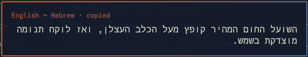

# Translate — an Omarchy plugin

Select text anywhere, press a key, and the translation pops up right next to
the mouse pointer. The translation is copied to the clipboard and kept in a
searchable history, the way the clipboard manager keeps your copies.



Translations come from [Crow Translate](https://github.com/crow-translate/crow-translate),
which uses its configured translation provider (by default a public
[Mozhi](https://codeberg.org/aryak/mozhi) instance in front of Google
Translate). The selected text is sent to that service.

## Install

```bash
omarchy pkg aur add crow-translate
omarchy plugin add https://github.com/dror5202/omarchy-translate --enable
```

Then add the keys to `~/.config/hypr/bindings.lua`. `code:28` is the T key by
keycode, so it also works when a non-Latin keyboard layout is active:

```lua
o.bind("SUPER + ALT + code:28", "Translate selection", "omarchy-shell drorko.translate translate")
o.bind("SUPER + ALT + code:43", "Translation history", "omarchy-shell drorko.translate history")

-- Optional: let SUPER+comma close the card like a notification, and otherwise
-- act on the last notification as usual. By keycode (59 = comma) so it also
-- works on non-Latin layouts.
hl.unbind("SUPER + comma")
o.bind("SUPER + code:59", "Dismiss translation or last notification",
  os.getenv("HOME") .. "/.config/omarchy/plugins/drorko.translate/bin/dismiss-or-notify")
```

Avoid ALT + SHIFT combinations if you switch keyboard layouts with Alt+Shift.

## Use

**Super + Alt + T** translates the selected text. Without a selection, it
translates the clipboard instead.

- The card stays while the mouse is over it, and goes away by itself after a
  few seconds.
- Left click copies the translation again and closes the card. Right click
  only closes it.
- Pressing the key again on the same selection closes the card.
- **Super + ,** closes it like a notification (with the optional binding).

**Super + Alt + H** opens the history:

| Key | Action |
|---|---|
| type | filter by original or translation |
| ↑ ↓ / PgUp PgDn | move |
| Enter / click | copy the translation |
| Shift + Enter | copy the original |
| Delete | remove the entry |
| Shift + Delete | clear the history |
| Esc | clear the filter, then close |

## Languages

Create `~/.config/omarchy/translate.json` and list the languages you want, in
order:

```json
{
  "languages": ["he", "en"],
  "copy": true
}
```

Text is translated into the first language. Text already written in the first
language is translated into the second language instead. Any number of
languages (up to 5) can be listed; run `crow -c` to see the codes.

Without the file, the first language is Omarchy's UI language and the second
is English. Set `"copy": false` to stop the translation from being copied to
the clipboard. Changes apply right away.

## Files

- History: `~/.local/state/omarchy/translate-history.json` (last 300 entries)
- Settings: `~/.config/omarchy/translate.json`

## IPC

```bash
omarchy-shell drorko.translate translate   # translate the selection
omarchy-shell drorko.translate history     # open / close the history
omarchy-shell drorko.translate close       # close the popup and history
omarchy-shell drorko.translate dismiss     # close the popup; prints "closed" or "none"
```

## Tests

```bash
node test/model.test.mjs
```

## License

MIT
